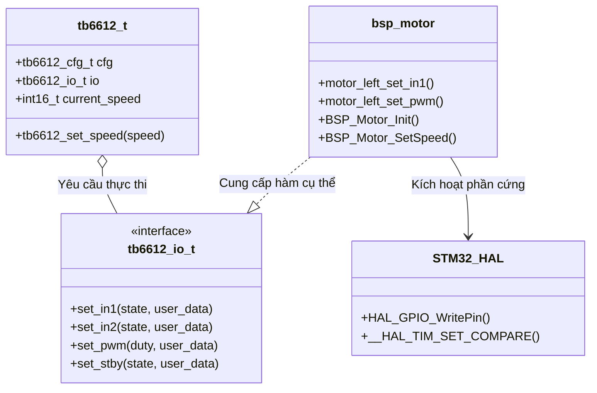
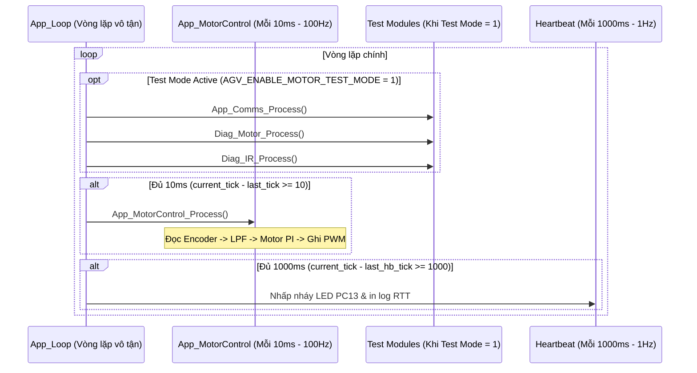

# Kiến trúc Hệ thống Phần mềm AGV STM32 (Software Architecture)

Tài liệu này mô tả chi tiết kiến trúc phần mềm, nguyên lý thiết kế, luồng dữ liệu và quy chuẩn phân tầng của firmware xe tự hành AGV STM32F103.

---

## 1. Tổng quan Kiến trúc 4 Tầng (4-Tier Architecture)

Firmware được xây dựng theo mô hình phân tầng chặt chẽ (Clean Architecture / Onion Architecture) nhằm tách biệt hoàn toàn giữa **logic thuật toán điều khiển** và **phần cứng vi điều khiển**.

```
┌────────────────────────────────────────────────────────────────────────────────────────┐
│                          1. APPLICATION LAYER (Nghiệp vụ AGV)                         │
│  app_main.c         app_motor_control.c   app_line_follow.c    app_comms.c (CLI)       │
│  - Vòng lặp chính   - Điều khiển motor PI - Thuật toán dò line - Điều phối lệnh RTT    │
│  - Điều phối mode   - Vòng kín 100Hz      - Vòng kín AGV                               │
└───────────────────────────┬────────────────────────────────────────┬───────────────────┘
                            │                                        │ (chỉ khi test mode)
                            │               ┌────────────────────────▼───────────────────┐
                            │               │        DIAGNOSTICS LAYER (Tự kiểm tra HW)  │
                            │               │  diag_motor.c         diag_ir.c            │
                            │               │  - Test xung Step     - Test 5 mắt ADC IR  │
                            │               │  - Đo RPM, Encoder    - Calib min/max      │
                            │               └────────┬───────────────────────────────────┘
                            │ (gọi Services/BSP)     │ (gọi Services/BSP)
┌───────────────────────────▼────────────────────────▼───────────────────────────────────┐
│                                2. SERVICES LAYER                                       │
│  (100% Pure C - Không phụ thuộc HAL - 100% Bộ nhớ tĩnh - Header: Inc/)                 │
│  - line_tracker: Chuẩn hóa quang học, tính sai số trọng tâm e_line, Line PID           │
│  - velocity_service: Tích hợp CPR, bộ lọc LPF và bộ điều khiển Motor PI                │
│  - comms_protocol: Phân tích cú pháp CLI và đóng gói bản tin phản hồi                  │
│  - kinematics: Động học vi sai AGV và tích phân Odometry 2D (x, y, th)                │
│  - motor_pi: Bộ điều khiển PI có bù ma sát (Feedforward) & Slew-rate                   │
│  - pid: Thuật toán PID Controller cơ bản có Anti-windup                               │
│  - filter: Bộ lọc số thông thấp bậc 1 (First-Order EMA Filter)                         │
│  - encoder: Giải thuật xử lý delta xung, bù tràn số Timer 16-bit                       │
│  - ring_buffer: Hàng đợi vòng FIFO phục vụ truyền nhận UART DMA                        │
└───────────────────────────────────────────┬────────────────────────────────────────────┘
                                            │ (truy xuất qua BSP Interface)
┌───────────────────────────────────────────▼────────────────────────────────────────────┐
│                             3. BSP & DRIVERS LAYER                                     │
│  ┌────────────────────────────────────────┐   ┌─────────────────────────────────────┐  │
│  │ BSP (Board Support Package)            │   │ Drivers (Hardware Drivers)          │  │
│  │ - bsp_ir: Adapter ADC1 Scan DMA 5 kênh │   │ - tb6612: IC H-Bridge Driver        │  │
│  │ - bsp_board: LED, Time tick            │   │ - SEGGER_RTT: Debug SWD             │  │
│  │ - bsp_motor: Adapter PWM/GPIO          │   │ - CMSIS: ARM Cortex-M3 Core         │  │
│  │ - bsp_encoder: Adapter Timer 4X        │   │ - STM32F1xx_HAL_Driver              │  │
│  │ - bsp_uart: Adapter UART1 DMA          │   │                                     │  │
│  └────────────────────────────────────────┘   └─────────────────────────────────────┘  │
└───────────────────────────────────────────┬────────────────────────────────────────────┘
                                            │ (thao tác trực tiếp thanh ghi / HAL)
┌───────────────────────────────────────────▼────────────────────────────────────────────┐
│                           4. MICROCONTROLLER CORE (CubeMX)                             │
│  main.c, gpio.c, tim.c, usart.c, dma.c, adc.c, stm32f1xx_it.c                           │
└────────────────────────────────────────────────────────────────────────────────────────┘
```

---

## 2. Ranh giới & Quy tắc Phân tầng (Layer Boundaries)

Để đảm bảo tính độc lập và khả năng bảo trì lâu dài, mã nguồn tuân thủ nghiêm ngặt các quy tắc:

| Tầng | Được phép gọi | Tuyệt đối KHÔNG được phép |
| :--- | :--- | :--- |
| **Application** | `Services`, `BSP` | Không gọi trực tiếp hàm `HAL_xxx`, không include thanh ghi phần cứng. |
| **Services** | Chỉ dùng thư viện C chuẩn (`stdint.h`, `stdbool.h`, `math.h`, `string.h`) | Không `#include` bất kỳ file nào của HAL hay BSP; 100% không có hardware side-effects. |
| **BSP** | Gọi `Drivers`, gọi các hàm `HAL_xxx` | Không chứa logic nghiệp vụ cấp cao (không tính toán động học, không chứa công thức PID). |
| **Drivers** | Tự định nghĩa bảng hàm callback phần cứng (IoC); độc lập vi điều khiển. | Không `#include` mã nguồn ứng dụng hay board STM32 cụ thể. |
| **Core** | Mã khởi tạo do STM32CubeMX sinh ra | Không chứa mã ngắt nghiệp vụ phức tạp (chuyển giao cho BSP qua callbacks). |

---

## 3. Cơ chế Đảo ngược Phụ thuộc (Inversion of Control - IoC)

Driver `tb6612` minh họa hoàn hảo cho mô hình Inversion of Control trong lập trình nhúng:



1. **`tb6612.h` định nghĩa Interface**: Struct `tb6612_io_t` gồm các con trỏ hàm điều khiển chân. `tb6612` chỉ tập trung vào bảng chân lý logic (tiến, lùi, phanh, tính duty, đảo chiều).
2. **`bsp_motor.c` thực thi Interface**: Cung cấp các hàm gọi `HAL_GPIO_WritePin` và `__HAL_TIM_SET_COMPARE(&htim4, ...)` rồi tiêm vào struct `tb6612_io_t`.
3. **Lợi ích**:
   - `tb6612` có thể biên dịch và chạy trên máy tính x86 phục vụ Unit Test mà không cần chip STM32.
   - Khi chuyển sang dòng vi điều khiển khác (ESP32, RP2040), toàn bộ file `tb6612.c` giữ nguyên 100%, chỉ cần viết lại file `bsp_motor` tương ứng.

---

## 4. Mô hình Bộ nhớ (Memory Budget & Static Allocation)

Firmware áp dụng nguyên lý **100% Bộ nhớ tĩnh (Zero Dynamic Allocation)** trong toàn bộ vòng đời chạy (runtime):
- **Không sử dụng `malloc()`, `free()` hay `calloc()`**: Loại trừ hoàn toàn nguy cơ phân mảnh bộ nhớ (heap fragmentation) hoặc cạn kiệt RAM sau thời gian dài vận hành.
- Toàn bộ struct dữ liệu (`velocity_channel_t`, `encoder_t`, `tb6612_t`, `ring_buffer_t`) đều được cấp phát tĩnh dạng `static` ở phạm vi module.
- Các buffer chuỗi văn bản nhận dạng lệnh CLI đều có kích thước cố định (`char rx_buf[64]`), kiểm tra tràn bộ đệm chặt chẽ chống Buffer Overflow.

### Tài nguyên RAM & Flash (STM32F103C8T6: 64KB Flash, 20KB RAM)

Số liệu đo lường thực tế từ bản build nhị phân `agv_stm32.elf`:

```
1. Chế độ Thi đấu / Vận hành Thực tế (AGV_ENABLE_MOTOR_TEST_MODE = 0):
├── RAM:   7,728 B / 20,480 B  (37.73% Used) - Còn trống > 12.7 KB
└── FLASH: 42,576 B / 65,536 B (64.97% Used) - Còn trống > 22.9 KB Flash (35.03%)

2. Chế độ Bàn test / Diagnostics (AGV_ENABLE_MOTOR_TEST_MODE = 1):
├── RAM:   8,184 B / 20,480 B  (39.96% Used) - Còn trống > 12.2 KB
└── FLASH: 59,108 B / 65,536 B (90.19% Used) - Kích hoạt đầy đủ RTT, CLI & Self-Test

=> Cơ chế Linker Garbage Collection (-Wl,--gc-sections) tự động loại bỏ:
   + 16,532 Bytes Flash (tiết kiệm 25.22% toàn bộ Flash của chip STM32)
   + 456 Bytes RAM
   khi chuyển sang bản firmware thi đấu chính thức mà không cần tách code thủ công!
```

---

## 5. Lập lịch & Điều phối Thời gian thực (Timing & Concurrency)

Dự án áp dụng mô hình **Cooperative Non-blocking Scheduling** (Lập lịch hợp tác bất đồng bộ) dựa trên bộ đếm tick phần cứng `bsp_time_get_ms()` mà không cần cài đặt RTOS cồng kềnh:



### An toàn số tràn (Tick Rollover Safety)
Các phép so sánh thời gian đều sử dụng toán tử trừ số nguyên không dấu:
```c
if ((uint32_t)(current_tick - last_tick) >= INTERVAL_MS) {
    last_tick = current_tick;
    // Thực thi tác vụ
}
```
Phép toán này đảm bảo an toàn tuyệt đối khi thanh ghi tick 32-bit bị tràn về 0 sau xấp xỉ 49.7 ngày hoạt động liên tục (đã có Unit Test kiểm chứng tại `tests/test_architecture_boundaries.py`).

---

## 6. Hướng dẫn Mở rộng Module Chẩn đoán Mới (`Diagnostics/`)

Khi bổ sung ngoại vi phần cứng mới vào xe (ví dụ cảm biến góc nghiêng IMU MPU6050 hoặc mạch đo dung lượng pin ADC `diag_battery`), hãy tuân thủ quy trình chuẩn hóa sau:

1. **Đặt tên file**: Tạo cặp file `Diagnostics/Inc/diag_<module>.h` và `Diagnostics/Src/diag_<module>.c` (ví dụ `diag_imu.h`, `diag_imu.c`).
2. **Quy ước API**:
   - `void Diag_<Module>_Init(void);`
   - `void Diag_<Module>_Start(...);`
   - `void Diag_<Module>_Stop(void);`
   - `bool Diag_<Module>_IsRunning(void);`
   - `const Diag_<Module>_Result_t* Diag_<Module>_GetLastResult(void);`
   - `void Diag_<Module>_Process(void);`
3. **Quy tắc phụ thuộc**:
   - `Diagnostics` chỉ được phép `#include` các tầng `BSP/` và `Services/`.
   - `Application` chỉ gọi `Diagnostics` khi cờ `AGV_ENABLE_MOTOR_TEST_MODE = 1`.
   - Tuyệt đối không đặt code kiểm thử phần cứng vào `Application/`.
4. **Khai báo Build & Test**:
   - Thêm `Diagnostics/Src/diag_<module>.c` vào `CMakeLists.txt`.
   - Viết bài test tương ứng `tests/test_diag_<module>.py`.


