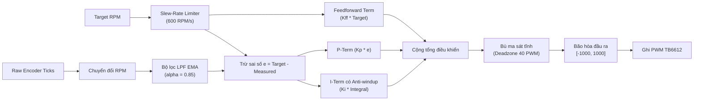

# Lý thuyết Điều khiển & Nhận dạng Động cơ (Control Theory & Motor Identification)

Tài liệu này giải thích cơ sở lý thuyết điều khiển tự động, mô hình toán học hàm truyền, cấu trúc bộ điều khiển vận tốc vòng kín (PI Controller) và phương pháp xác định tham số cho động cơ xe AGV.

---

## 1. Nhận dạng Hệ thống & Mô hình Hàm truyền (System Identification)

Hệ thống truyền động gồm động cơ DC có chổi than, hộp giảm tốc và tải trọng bánh xe được kích thích bằng tín hiệu đầu vào **bước nhảy đơn vị (Unit Step Response)** ở mức 80% PWM (800 / 1000). Dữ liệu tốc độ phản hồi được thu thập theo thời gian thực ở chu kỳ $T_s = 10\text{ ms}$.

Qua công cụ phân tích tự động `scripts/plot_step_response.py`, động cơ được mô hình hóa theo dạng **Hệ bậc nhất có trễ (First-Order System)**:

$$G(s) = \frac{\Omega(s)}{U(s)} = \frac{K}{\tau s + 1}$$

### Các thông số nhận dạng được từ thực nghiệm:
- **Hệ số khuếch đại tĩnh (DC Gain $K$)**: $K \approx 0.2699 \text{ RPM / PWM}$
  - Ở 80% PWM (800 đơn vị), vận tốc xác lập đạt $\omega_{ss} \approx 216 \text{ RPM}$.
- **Hằng số thời gian ($\tau$)**: $\tau \approx 0.0449 \text{ s}$ ($44.9\text{ ms}$)
  - Thời gian để động cơ tăng tốc đạt 63.2% vận tốc xác lập ($136.5\text{ RPM}$).
- **Thời gian tăng ($t_r$, 10% đến 90%)**: $t_r \approx 98.6\text{ ms}$.
- **Thời gian xác lập ($t_s$, dải sai số 2%)**: $t_s \approx 175\text{ ms}$.
- **Độ vọt lố (Overshoot)**: $\approx 0\%$ (hệ thống có tính chất quán tính thuần túy, quá tắt dần).

---

## 2. Cấu trúc Bộ điều khiển Vận tốc Vòng kín (Velocity Control Pipeline)

Mỗi chu kỳ điều khiển ($T_s = 10\text{ ms}$ / tần số $100\text{ Hz}$), chuỗi tính toán diễn ra theo thứ tự sau trong `Services/Src/velocity_service.c` và `Services/Src/motor_pi.c`:



---

## 3. Các thành phần Thuật toán Chi tiết

### 3.1. Tính toán Vận tốc thô & Lọc số thông thấp (LPF / EMA)
Vận tốc góc tức thời của bánh xe (vòng/phút - RPM) được tính từ số xung Encoder $\Delta \text{ticks}$ ghi nhận trong chu kỳ $\Delta t$:

$$\omega_{raw} = \frac{\Delta \text{ticks}}{\text{CPR}} \times \frac{60}{\Delta t}$$

Do tín hiệu đếm xung số ở chu kỳ nhỏ ($10\text{ ms}$) thường chứa nhiễu lượng tử hóa (quantization noise), vận tốc được đưa qua bộ lọc số trung bình động hàm mũ (Exponential Moving Average - EMA):

$$\omega_{filtered}[k] = \alpha \cdot \omega_{filtered}[k-1] + (1 - \alpha) \cdot \omega_{raw}[k]$$

Trong đó hệ số lọc mặc định $\alpha = 0.85$ giúp triệt tiêu xung gai tần số cao trong khi vẫn giữ trễ pha thấp ($< 15\text{ ms}$).

---

### 3.2. Bộ giới hạn Gia tốc (Slew-Rate Limiter)
Để chống giật cơ khí và tránh sụt áp nguồn pin khi đổi tốc độ đột ngột, tốc độ mục tiêu được làm trơn theo gia tốc tối đa:

$$|\Delta \omega_{target}| \le a_{max} \times \Delta t$$

Với $a_{max} = 600\text{ RPM/s}$, trong $10\text{ ms}$ vận tốc tăng/giảm tối đa là $6\text{ RPM}$.

---

### 3.3. Điều khiển Tiến định (Feedforward Friction Compensation)
Thành phần Feedforward dự đoán trước điện áp cần thiết dựa trên mô hình tĩnh của động cơ:

$$u_{ff} = K_{ff} \times \omega_{target}$$

Với $K_{ff} = \frac{1}{K} \approx 3.705\text{ PWM / RPM}$. Nhờ có Feedforward, phản ứng bám tốc độ của xe diễn ra gần như tức thời ($0\text{ ms}$ trễ do không phải chờ sai số tích lũy).

---

### 3.4. Bộ điều khiển PI có chống bão hòa tích phân (Anti-windup)
- **Thành phần tỉ lệ (Proportional)**: $u_p = K_p \times e[k]$ với $e[k] = \omega_{target} - \omega_{filtered}[k]$.
- **Thành phần tích phân (Integral)**: Triệt tiêu sai số xác lập do ma sát và tải trọng thay đổi:
  
  $$I[k] = \text{clamp}\left(I[k-1] + K_i \times e[k] \times \Delta t, -I_{max}, +I_{max}\right)$$
  
  Với giới hạn kẹp tích phân $I_{max} = 400.0\text{ PWM}$, ngăn chặn hiện tượng vọt lố khi động cơ khởi động hoặc bị kẹt bánh.

---

### 3.5. Bù Ma sát tĩnh / Vùng chết (Deadzone Compensation)
Động cơ và hộp số luôn có lực ma sát tĩnh Coulomb. Ở các mức PWM nhỏ ($< 40$), động cơ không thể quay. Thuật toán tự động bù bước nhảy điện áp khi xe chuyển động:

$$u_{out} = \begin{cases} 
u + u_{deadzone} & \text{khi } u > 0 \\
u - u_{deadzone} & \text{khi } u < 0 \\
0 & \text{khi } u = 0 
\end{cases}$$

---

### 3.6. Cơ chế Xử lý Bão hòa Công suất & Khóa Chống Tràn Tích phân (Anti-Windup Clamping)
Khi vận tốc yêu cầu hoặc tải trọng đòi hỏi công suất vượt quá 100% duty cycle ($> 1000$ đơn vị PWM):
1. **Bão hòa đầu ra (Output Saturation Clamping)**: Ngõ ra bị kẹp cứng tại $u_{out} \in [-1000, 1000]$.
2. **Khóa chống tràn tích phân (Anti-Windup Clamping)**: Nếu ngõ ra đã chạm ngưỡng bão hòa ($|u_{out}| \ge 1000$) mà sai số vận tốc vẫn cùng dấu ($e > 0$ khi tăng tốc hoặc $e < 0$ khi giảm tốc), khâu tích phân **ngừng cộng dồn tích lũy** (`ctrl->integral += 0`).
   - **Tác dụng**: Triệt tiêu hoàn toàn độ trễ xả tích phân (*Windup Lag*). Khi xe cần phanh hoặc giảm tốc, phản hồi diễn ra tức thì trong 1 chu kỳ $10\text{ ms}$ mà không bị kẹt ở tốc độ cao.

---

### 3.7. Ánh xạ Chuẩn hóa Tỷ lệ PWM Tầng BSP (Duty Cycle Hardware Scaling)
- **Tầng Thuật toán & Ứng dụng**: Sử dụng dải số chuẩn hóa $u \in [0, 1000]$ (`BSP_MOTOR_MAX_SPEED = 1000`), trong đó $400$ tương ứng với $40\%$ công suất.
- **Tầng Phần cứng Timer (TIM4)**: Được CubeMX cấu hình ở chu kỳ đếm $\text{Period} = 3599$ ($\text{ARR} = 3600$ counts) để đạt tần số băm xung siêu âm $20\text{ kHz}$ tại xung nhịp $72\text{ MHz}$.
- **Công thức ánh xạ tại `BSP/Src/bsp_motor.c`**:
  
  $$\text{CCR} = \frac{\text{duty} \times \text{TIM4\_PERIOD}}{\text{BSP\_MOTOR\_MAX\_SPEED}} = \frac{\text{duty} \times 3599}{1000}$$
  
  *Lưu ý kỹ thuật*: Nếu ghi trực tiếp `duty = 400` vào thanh ghi `CCR` mà không ánh xạ, chu kỳ nhiệm vụ thực tế chỉ là $400 / 3600 = 11.11\%$, khiến điện áp động cơ bị sụt xuống chỉ còn $4.9\text{V} \times 11.11\% \approx 0.54\text{V}$. Nhờ có ánh xạ tỷ lệ, `CCR = 1439`, chu kỳ nhiệm vụ đạt đúng $40\%$, điện áp ra đạt chuẩn $4.9\text{V} \times 40\% = 1.96\text{V}$.

---

## 4. Mối Quan Hệ Giữa Điện Áp Nguồn $V_m$ và Vận Tốc Cực Đại $\text{RPM}_{\text{max}}$

Khi thay đổi điện áp nguồn cấp động cơ $V_m$ (ví dụ: chuyển từ cổng USB 5V sang pin LiPo 2S 7.4V hoặc 3S 11.1V):
1. **Đặc tuyến vận tốc không tải cực đại**: Vận tốc cực đại $\text{RPM}_{\text{max}}$ tỉ lệ thuận với điện áp cấp $V_m$.
2. **Cách đo thực tế**: Chạy lệnh kích xung $100\%$ trong $2.5\text{ s}$ qua RTT:
   ```text
   MOT A 1000 2500
   ```
   Dòng log `[STEP_TEST]` trả về trường `Steady: <val> RPM` chính là $\text{RPM}_{\text{max}}$ thực tế ở điện áp đó.
3. **Cập nhật hệ số mô hình**:
   - Độ lợi tĩnh mới: $K = \frac{\text{RPM}_{\text{max}}}{1000}$
   - Hệ số Feedforward mới: $K_{ff} = \frac{1}{K} = \frac{1000}{\text{RPM}_{\text{max}}}$
4. **Vùng dự phòng công suất đánh lái (Headroom)**:
   Để đảm bảo khi bẻ cua gấp, bánh ngoài cua có đủ công suất tăng tốc mà không bị chạm trần $100\%$ duty, khuyến nghị đặt tốc độ cơ sở:
   
   $$v_{base} \approx 50\% \sim 65\% \text{ của } \text{RPM}_{\text{max}}$$

---

## 5. Bảng Thông số Mặc định & Hướng dẫn Căn chỉnh (Tuning Guide)

| Tham số | Giá trị mặc định | Đơn vị | File cấu hình | Ý nghĩa & Hướng dẫn căn chỉnh |
| :--- | :---: | :---: | :--- | :--- |
| **`CPR`** | `1320` | Xung/Vòng | `bsp_encoder.c` | Số xung 4X trên 1 vòng quay bánh xe. |
| **`alpha`** | `0.85` | - | `motor_pi.h` | Hệ số lọc LPF. Tăng nếu tín hiệu vận tốc rung lắc, giảm nếu phản hồi bị trễ. |
| **`kp` (Motor PI)** | `5.04` | PWM/RPM | `motor_pi.h` | Hệ số tỉ lệ động cơ. Tăng để xe bám tốc độ cứng hơn; giảm nếu thấy bánh rung giật. |
| **`ki` (Motor PI)** | `112.3` | PWM/(RPM·s) | `motor_pi.h` | Hệ số tích phân động cơ. Triệt tiêu sai số xác lập khi xe leo dốc hoặc chở nặng. |
| **`k_ff`** | `3.705` | PWM/RPM | `motor_pi.h` | Hệ số bù tiến định ($1/K$). Đặt bằng $1000 / \text{RPM}_{\text{max}}$. |
| **`deadzone`** | `40.0` | PWM | `motor_pi.h` | Bù ma sát khởi động (4% PWM). |
| **`max_accel`**| `600.0` | RPM/s | `motor_pi.h` | Gia tốc dốc tối đa. Giúp xe tăng/giảm tốc êm ái, không sụt áp pin. |
| **`base_rpm`** | `80.0` | RPM | `app_config.h` | Tốc độ cơ sở khi tự hành bám line. |
| **`kp` (Line PID)**| `0.15` | RPM/Error | `app_line_follow.c` | Hệ số tỉ lệ bẻ lái bám vạch. |
| **`ki` (Line PID)**| `0.0` | RPM/(Error·s) | `app_line_follow.c` | **Triệt tiêu hoàn toàn** để loại bỏ hiện tượng lắc lư hình sin (hunting). |
| **`kd` (Line PID)**| `0.035` | RPM·s/Error | `app_line_follow.c` | Hệ số vi sai giảm chấn (damping), dập tắt dao động khi đổi góc cua. |
| **`out_max` (Line PID)** | `max(60.0, base)` | RPM | `app_line_follow.c` | Giới hạn vi sai bẻ lái, cho phép bánh trong phanh về 0 RPM khi ôm cua gắt. |
| **`LINE_LOST_TIMEOUT_MS`** | `2000` | ms | `app_line_follow.c` | Thời gian tự ngắt khẩn cấp khi mất vạch liên tục (2.0 giây). |

---

## 6. Động Học Bám Line & Tự Động Nhận Dạng (Step Response Auto-Tuning)

### 6.1. Động học Bẻ cua Vi sai & Bán kính Quay vòng Tối thiểu
Với khoảng cách giữa hai tâm bánh xe (track width) $W \approx 130\text{ mm}$, quan hệ giữa vận tốc hai bánh và bán kính quay vòng $R$ tại tâm trục xe là:

$$R = \frac{W}{2} \cdot \frac{v_{ngoài} + v_{trong}}{v_{ngoài} - v_{trong}} = \frac{W}{2} \cdot \frac{2 v_{base}}{2 \Delta v} = \frac{W}{2} \cdot \frac{v_{base}}{\Delta v}$$

- **Trường hợp $\Delta v < v_{base}$ (Thiếu lái / Understeer)**:
  Nếu giới hạn vi sai $\Delta v$ bị kẹp ở mức thấp (ví dụ $\text{out\_max} = 40\text{ RPM}$ khi $v_{base} = 90\text{ RPM}$):
  $$v_{trong} = 90 - 40 = 50\text{ RPM} \implies R_{min} = \frac{130}{2} \cdot \frac{180}{80} \approx 146.25\text{ mm}$$
  Xe không thể bẻ đủ góc cho các khúc cua vuông $90^\circ$ có bán kính nhỏ ($R \le 100\text{ mm}$) và sẽ bị văng khỏi vạch.
- **Trường hợp $\Delta v = v_{base}$ (Quay quanh bánh trong / Pivot Turn)**:
  Nhờ cơ chế co giãn thích ứng $\text{out\_max} = \max(60.0f, v_{base})$, tại $v_{base} = 90\text{ RPM} \implies \text{out\_max} = 90\text{ RPM}$:
  $$v_{trong} = 90 - 90 = 0\text{ RPM} \implies R_{min} = \frac{W}{2} \approx 65\text{ mm}$$
  Bánh trong dừng hẳn làm điểm tựa, xe quay quanh tâm bánh trong và ôm trọn góc cua gắt.

### 6.2. Tại sao Khâu Tích phân $K_i$ Bằng 0 Trong Điều Khiển Line PID?
Trong bài toán bám line xe hai bánh vi sai, biến điều khiển là sai số vị trí tâm vạch $e_{line} \in [-1000, +1000]$ với Setpoint luôn là $0$.
- Nếu có $K_i > 0$, trong quá trình xe điều chỉnh từ mép vạch về tâm vạch, tích phân sai số tích lũy một lượng $\int e\, dt \ne 0$.
- Khi tâm xe vừa chạm vào vạch ($e = 0$), lượng bù tích phân này vẫn còn duy trì điện áp bẻ lái, ép xe tiếp tục vượt quá tâm sang phía đối diện.
- Hiện tượng này lặp đi lặp lại tạo thành **chu kỳ dao động con lắc (hunting oscillation)** quanh vạch với biên độ nhỏ.
- **Giải pháp chuẩn xác**: Đặt $K_i = 0.0f$, tăng $K_p = 0.15f$ và dùng khâu vi sai $K_d = 0.035f$ để làm tắt dần quán tính.

### 6.3. Thuật toán Step Response Auto-Tuner Trên BLE GUI Dashboard
Công cụ [`agv_esp32/tools/agv_ble_gui.py`](../agv_esp32/tools/agv_ble_gui.py) tích hợp thuật toán nhận dạng đáp ứng bước nhảy tự động:
1. Kích xung PWM $U_{step}$ và thu thập dữ liệu vận tốc phản hồi $\Omega(t)$.
2. Xác định vận tốc xác lập $\Omega_{ss}$, tính hệ số khuếch đại tĩnh quy đổi về 100% công suất:
   $$K = \frac{\Omega_{ss}}{U_{step}}, \quad \text{RPM}_{\max} = K \times 1000$$
3. Tìm thời điểm $t_{63.2\%}$ để xác định hằng số thời gian $\tau$.
4. Tự động tính toán bộ thông số tối ưu:
   - Feedforward Gain: $K_{ff} = \frac{1000}{\text{RPM}_{\max}}$
   - Proportional Gain: $K_p = \frac{\tau}{K \cdot \tau_{cl}}$ (với thời gian đáp ứng vòng kín mục tiêu $\tau_{cl} = 30\text{ ms}$)
   - Integral Gain: $K_i = \frac{K_p}{\tau}$
5. Đề xuất vận tốc bám line an toàn (Safe Line Speed):
   $$v_{safe} = (60\% \sim 70\%) \times \text{RPM}_{\max}$$
   Đảm bảo luôn có từ 30% đến 40% dự phòng công suất (Headroom) cho bánh ngoài cua khi cần tăng tốc bẻ góc.


