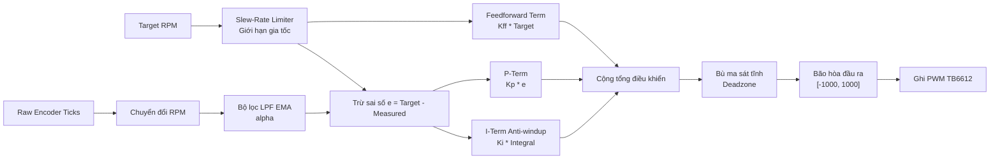

# Lý Thuyết Điều Khiển Và Nhận Dạng Động Cơ

Tài liệu này giải thích cơ sở lý thuyết điều khiển tự động, mô hình toán học hàm truyền, cấu trúc bộ điều khiển vận tốc vòng kín và phương pháp xác định tham số cho hệ thống truyền động xe AGV.

---

## 1. Mô Hình Toán Học Và Nhận Dạng Hệ Thống

Hệ thống truyền động gồm động cơ DC có chổi than, hộp giảm tốc và quán tính bánh xe khi được kích thích bằng tín hiệu điện áp bước nhảy (Step Response) có thể được mô hình hóa theo dạng **hệ quán tính bậc nhất**:

$$G(s) = \frac{\Omega(s)}{U(s)} = \frac{K}{\tau s + 1}$$

Trong đó:
- $\Omega(s)$: Tốc độ quay của bánh xe sau hộp giảm tốc.
- $U(s)$: Tín hiệu điều khiển PWM cấp cho cầu H TB6612 (chuẩn hóa trong khoảng $0 \dots 1000$).
- $K$: **Hệ số khuếch đại tĩnh** (DC Gain, đơn vị $\text{RPM / PWM}$), thể hiện tỉ số giữa vận tốc xác lập và mức PWM kích thích:
  $$K = \frac{\Omega_{ss}}{U_{step}}$$
- $\tau$: **Hằng số thời gian cơ học** (giây), là thời gian cần thiết để vận tốc động cơ tăng từ $0$ đạt đến $63.2\%$ vận tốc xác lập $\Omega_{ss}$.
- $t_r$: Thời gian tăng (Rise Time), thời gian để vận tốc tăng từ $10\%$ đến $90\%$ vận tốc xác lập:
  $$t_r \approx 2.2 \times \tau$$
- $t_s$: Thời gian xác lập (Settling Time, theo dải sai số $2\%$):
  $$t_s \approx 4 \times \tau$$

> [!NOTE]
> Các thông số $K$ và $\tau$ phụ thuộc trực tiếp vào động cơ thực tế, tải trọng khung xe và điện áp nguồn cấp. Chúng ta không gán trước các giá trị cố định mà sẽ đo đạc và nhận dạng trực tiếp trên xe thông qua bài kiểm tra bước nhảy (Step Test) hoặc bộ nhận dạng tự động (Auto-Tuner) trên Desktop GUI.

---

## 2. Cấu Trúc Bộ Điều Khiển Vận Tốc Vòng Kín

Mỗi chu kỳ điều khiển ($T_s = 10\text{ ms}$, tần số $100\text{ Hz}$), chuỗi tính toán vận tốc diễn ra trong `Services/Src/velocity_service.c` và `Services/Src/motor_pi.c`:

---

## 3. Các Thành Phần Thuật Toán Chi Tiết

### 3.1. Tính Toán Vận Tốc Và Lọc Thông Thấp EMA
Vận tốc góc tức thời của bánh xe (vòng/phút - RPM) được tính từ số xung Encoder $\Delta \text{ticks}$ ghi nhận trong chu kỳ $\Delta t$:

$$\omega_{raw} = \frac{\Delta \text{ticks}}{\text{CPR}} \times \frac{60}{\Delta t}$$

Trong đó $\text{CPR}$ (Counts Per Revolution) là tổng số xung thu được sau hộp giảm tốc trên 1 vòng bánh xe ở chế độ đọc 4X (sẽ được cấu hình chính xác theo thông số động cơ thực tế).

Tín hiệu đo xung ở chu kỳ ngắn ($10\text{ ms}$) thường chứa nhiễu lượng tử hóa. Vận tốc được làm trơn qua bộ lọc trung bình động hàm mũ (Exponential Moving Average - EMA):

$$\omega_{filtered}[k] = \alpha \cdot \omega_{filtered}[k-1] + (1 - \alpha) \cdot \omega_{raw}[k]$$

Hệ số lọc $\alpha \in [0.8, 0.9]$ giúp triệt tiêu gai xung tần số cao mà vẫn giữ độ trễ pha ở mức thấp ($< 15\text{ ms}$).

---

### 3.2. Bộ Giới Hạn Gia Tốc (Slew-Rate Limiter)
Để chống giật cơ khí và tránh sụt áp nguồn pin khi đổi tốc độ đột ngột, tốc độ mục tiêu được làm trơn theo gia tốc dốc tối đa $a_{max}$:

$$|\Delta \omega_{target}| \le a_{max} \times \Delta t$$

---

### 3.3. Điều Khiển Tiến Định (Feedforward)
Thành phần Feedforward dự đoán trước điện áp cần thiết dựa trên mô hình tĩnh của động cơ:

$$u_{ff} = K_{ff} \times \omega_{target}$$

Hệ số bù Feedforward được xác định từ hệ số khuếch đại tĩnh:

$$K_{ff} = \frac{1}{K} = \frac{U_{max}}{\text{RPM}_{max}}$$

Nhờ có Feedforward, bánh xe có thể đạt ngay gần đúng tốc độ mong muốn mà không phải chờ sai số tích phân tích lũy dần.

---

### 3.4. Bộ Điều Khiển PI Có Chống Bão Hòa Tích Phân
- **Thành phần tỉ lệ (Proportional)**: $u_p = K_p \times e[k]$ với $e[k] = \omega_{target} - \omega_{filtered}[k]$.
- **Thành phần tích phân (Integral)**: Triệt tiêu sai số xác lập khi xe mang tải hoặc chuyển hướng:
  
  $$I[k] = \text{clamp}\left(I[k-1] + K_i \times e[k] \times \Delta t, -I_{max}, +I_{max}\right)$$

---

### 3.5. Bù Ma Sát Tĩnh (Deadzone Compensation)
Động cơ và hộp số luôn có lực ma sát tĩnh Coulomb. Ở các mức PWM quá nhỏ, động cơ chưa thể thắng ma sát để quay. Thuật toán tự động cộng thêm mức bù điện áp $u_{deadzone}$ khi xe chuyển động:

$$u_{out} = \begin{cases} 
u + u_{deadzone} & \text{khi } u > 0 \\
u - u_{deadzone} & \text{khi } u < 0 \\
0 & \text{khi } u = 0 
\end{cases}$$

Thông số $u_{deadzone}$ được xác định bằng thực nghiệm bằng cách tăng dần PWM từ 0 đến khi bánh xe bắt đầu quay.

---

### 3.6. Xử Lý Bão Hòa Công Suất Và Khóa Chống Tràn Tích Phân (Anti-Windup Clamping)
Khi vận tốc yêu cầu hoặc tải trọng đòi hỏi công suất vượt quá giới hạn:
1. **Bão hòa đầu ra**: Ngõ ra bị kẹp cứng trong dải $[-1000, 1000]$.
2. **Khóa chống tràn tích phân (Anti-Windup Clamping)**: Nếu ngõ ra đã chạm ngưỡng bão hòa mà sai số vận tốc vẫn cùng dấu, khâu tích phân ngừng tích lũy (`ctrl->integral += 0`).
   - Nhờ đó, khi xe cần phanh hoặc giảm tốc, phản hồi diễn ra tức thì mà không bị kẹt trễ do lượng tích phân dư thừa.

---

### 3.7. Ánh Xạ Chuẩn Hóa Chu Kỳ Nhiệm Vụ PWM
- Tầng điều khiển sử dụng dải chuẩn hóa $u \in [0, 1000]$.
- Tầng phần cứng Timer (TIM4) cấu hình ở chu kỳ đếm $\text{ARR} = 3600$ counts để đạt tần số băm xung $20\text{ kHz}$ tại xung nhịp $72\text{ MHz}$.
- Công thức ánh xạ:
  $$\text{CCR} = \frac{\text{duty} \times \text{ARR}}{\text{BSP\_MOTOR\_MAX\_SPEED}} = \frac{\text{duty} \times 3599}{1000}$$

---

## 4. Ảnh Hưởng Của Điện Áp Nguồn Và Dự Phòng Công Suất Đánh Lái

1. **Vận tốc cực đại $\text{RPM}_{max}$ tỉ lệ với điện áp nguồn cấp $V_m$**:
   Khi thay đổi nguồn cấp (ví dụ chuyển từ 5V sang pin LiPo 2S 7.4V), tốc độ tối đa không tải sẽ thay đổi theo.
2. **Xác định $\text{RPM}_{max}$ thực tế**:
   Chạy thử nghiệm kích xung 100% PWM qua lệnh chẩn đoán `STEP_TEST` để đo tốc độ xác lập $\text{RPM}_{max}$ ở mức nguồn thực tế.
3. **Cập nhật hệ số mô hình**:
   $$K = \frac{\text{RPM}_{max}}{1000}, \quad K_{ff} = \frac{1000}{\text{RPM}_{max}}$$
4. **Dự phòng công suất đánh lái (Headroom)**:
   Để đảm bảo khi bẻ cua gấp, bánh phía ngoài có đủ công suất tăng tốc mà không bị chạm trần 100% PWM, vận tốc cơ sở khi chạy bám line nên đặt trong khoảng:
   $$v_{base} \approx 50\% \sim 65\% \text{ của } \text{RPM}_{max}$$

---

## 5. Danh Mục Tham Số Điều Khiển Và Hướng Dẫn Căn Chỉnh

| Tham số | Vai trò | Cách xác định trên phần cứng thực tế |
| :--- | :--- | :--- |
| **`CPR`** | Độ phân giải Encoder | Số xung đọc được trên 1 vòng bánh xe sau hộp giảm tốc (chế độ đọc Timer 4X). Cần kiểm tra theo mã động cơ thực tế. |
| **`alpha`** | Hệ số lọc số EMA vận tốc | Đặt trong khoảng $0.80 \dots 0.90$. Tăng nếu tín hiệu vận tốc đo bị rung nhiễu; giảm nếu phản hồi bị trễ. |
| **`k_ff`** | Hệ số bù tiến định | Tính theo công thức $K_{ff} = 1000 / \text{RPM}_{max}$ sau khi đo bước nhảy $100\%$ PWM. |
| **`kp` (Motor PI)** | Hệ số tỉ lệ điều khiển vận tốc | Tự động tính toán từ Auto-Tuner hoặc căn chỉnh tăng dần trên bàn test đến khi bánh bám tốc nhanh và êm. |
| **`ki` (Motor PI)** | Hệ số tích phân triệt tiêu sai số | Tự động tính toán từ Auto-Tuner hoặc căn chỉnh để triệt tiêu sai số xác lập khi xe có tải. |
| **`deadzone`** | Bù ma sát khởi động | Xác định bằng cách tăng dần PWM từ 0 đến khi bánh xe bắt đầu chuyển động. |
| **`max_accel`** | Giới hạn gia tốc dốc | Giúp xe tăng/giảm tốc êm ái, tránh trượt bánh khi khởi hành và không gây sụt áp pin. |
| **`base_rpm`** | Tốc độ cơ sở khi bám line | Chọn trong khoảng $50\% \dots 65\%$ của $\text{RPM}_{max}$. |
| **`kp` (Line PID)** | Hệ số tỉ lệ bẻ lái bám vạch | Căn chỉnh trực tiếp trên sa bàn để xe bám theo tâm đường line. |
| **`ki` (Line PID)** | Hệ số tích phân bám vạch | **Luôn đặt bằng 0** để triệt tiêu hoàn toàn hiện tượng rung lắc hình sin quanh vạch (hunting). |
| **`kd` (Line PID)** | Hệ số vi sai giảm chấn | Dập tắt dao động và ổn định thân xe khi chuyển hướng hoặc vào cua. |
| **`out_max` (Line PID)** | Giới hạn vi sai bẻ lái | Cấu hình theo cơ chế thích ứng $\max(60.0, v_{base})$ để bánh trong có thể phanh khi gặp cua gắt. |
| **`LINE_LOST_TIMEOUT_MS`** | Thời gian ngắt an toàn | Ngắt động cơ khẩn cấp khi mất vạch liên tục (mặc định 2.0 giây). |

---

## 6. Động Học Bám Line Và Nhận Dạng Tự Động

### 6.1. Động Học Bẻ Cua Vi Sai Và Bán Kính Quay Vòng
Gọi $W$ là khoảng cách giữa hai tâm bánh xe (track width, đo đạc thực tế trên khung xe). Mối quan hệ giữa vận tốc hai bánh và bán kính quay vòng $R$ tại tâm trục xe là:

$$R = \frac{W}{2} \cdot \frac{v_{ngoài} + v_{trong}}{v_{ngoài} - v_{trong}} = \frac{W}{2} \cdot \frac{2 v_{base}}{2 \Delta v} = \frac{W}{2} \cdot \frac{v_{base}}{\Delta v}$$

- **Trường hợp $\Delta v < v_{base}$ (Thiếu lái)**:
  Nếu giới hạn vi sai $\Delta v$ bị kẹp ở mức quá nhỏ so với vận tốc cơ sở $v_{base}$, bán kính quay vòng tối thiểu sẽ lớn:
  $$R_{min} = \frac{W}{2} \cdot \frac{v_{base}}{\Delta v_{max}} > \frac{W}{2}$$
  Khi gặp khúc cua có bán kính nhỏ hơn $R_{min}$, xe không thể bo hết góc cua và sẽ bị văng khỏi vạch dẫn hướng.
- **Trường hợp $\Delta v = v_{base}$ (Quay quanh bánh trong)**:
  Khi cơ chế vi sai cho phép $\text{out\_max} \ge v_{base}$, bánh phía trong khúc cua được phanh về $0\text{ RPM}$ ($v_{trong} = 0$):
  $$R_{min} = \frac{W}{2}$$
  Xe sẽ xoay quanh điểm tựa là bánh trong và ôm trọn góc cua gắt.

---

### 6.2. Lý Do Khâu Tích Phân $K_i$ Bằng 0 Trong Line PID
Trong bài toán bám line xe hai bánh vi sai, biến điều khiển là sai số vị trí tâm vạch $e_{line} \in [-1000, +1000]$ với điểm đặt Setpoint luôn là $0$.
- Nếu sử dụng $K_i > 0$, trong quá trình xe điều chỉnh từ mép vạch về tâm vạch, tích phân sai số tích lũy một lượng $\int e\, dt \ne 0$.
- Khi tâm xe vừa chạm vào vạch ($e = 0$), lượng bù tích phân này vẫn còn duy trì điện áp bẻ lái, ép xe tiếp tục vượt quá tâm sang phía đối diện.
- Hiện tượng này lặp đi lặp lại tạo thành **chu kỳ dao động con lắc (hunting)** quanh vạch.
- **Giải pháp**: Đặt $K_i = 0.0$, sử dụng $K_p$ kết hợp khâu vi sai $K_d$ để dập tắt quán tính dao động.

---

### 6.3. Thuật Toán Nhận Dạng Tự Động (Step Response Auto-Tuner)
Công cụ Desktop GUI tích hợp thuật toán nhận dạng đáp ứng bước nhảy tự động:
1. Kích xung PWM $U_{step}$ và thu thập chuỗi dữ liệu vận tốc phản hồi $\Omega(t)$.
2. Xác định vận tốc xác lập $\Omega_{ss}$, tính hệ số khuếch đại tĩnh quy đổi về $100\%$ công suất:
   $$K = \frac{\Omega_{ss}}{U_{step}}, \quad \text{RPM}_{max} = K \times 1000$$
3. Tìm thời điểm $t_{63.2\%}$ để xác định hằng số thời gian quán tính $\tau$.
4. Tự động tính toán bộ thông số điều khiển:
   - Hệ số bù Feedforward: $K_{ff} = \frac{1000}{\text{RPM}_{max}}$
   - Hệ số tỉ lệ: $K_p = \frac{\tau}{K \cdot \tau_{cl}}$ (với thời gian đáp ứng vòng kín mục tiêu $\tau_{cl}$)
   - Hệ số tích phân: $K_i = \frac{K_p}{\tau}$
5. Đề xuất vận tốc bám line an toàn:
   $$v_{safe} = (50\% \sim 65\%) \times \text{RPM}_{max}$$
   Đảm bảo luôn có đủ dự phòng công suất cho bánh ngoài khúc cua tăng tốc khi cần bẻ lái gấp.
