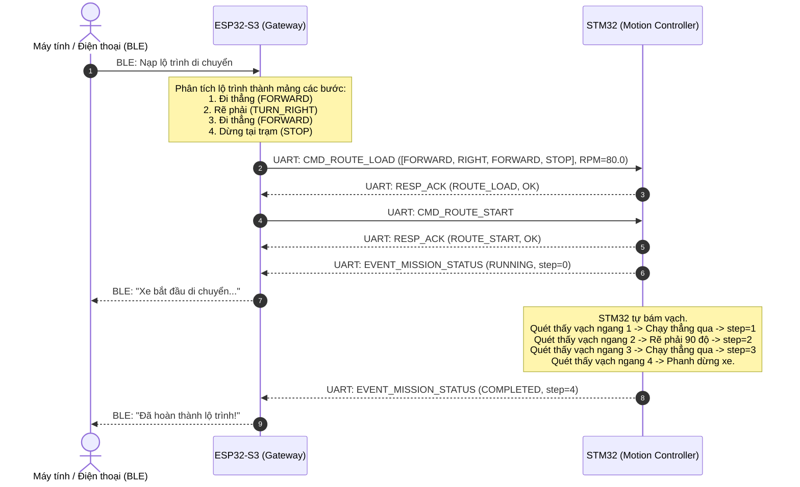

# Hướng Dẫn Phát Triển Firmware ESP32: Giao Tiếp UART Nhị Phân Với STM32 AGV

Tài liệu này cung cấp toàn bộ đặc tả kỹ thuật, sơ đồ phần cứng và bảng mã lệnh nhị phân phục vụ phát triển firmware giao tiếp UART giữa ESP32 và STM32F103C8T6.

---

## 1. Kết Nối Phần Cứng

### 1.1 Sơ Đồ Chân Nối
| Tín Hiệu | Chân STM32F103 | Chân Freenove ESP32-S3 CAM | Ghi Chú Kỹ Thuật |
|---|---|---|---|
| **TX ➔ RX** | `PA9` (USART1_TX) | `GPIO 41` (UART1_RX) | STM32 truyền telemetry & log sang ESP32-S3 |
| **RX 🠄 TX** | `PA10` (USART1_RX) | `GPIO 42` (UART1_TX) | ESP32-S3 truyền lệnh xuống STM32 |
| **GND** | `GND` | `GND` | **Bắt buộc chung mass (Common Ground)** |
| **Nguồn 3.3V / 5V**| `3.3V` / `5V` | Nguồn chung | Mức logic cả 2 MCU là 3.3V TTL (tương thích 100%) |

> [!IMPORTANT]
> **Điện áp logic & Cách ly Camera**: STM32F103 và ESP32-S3 đều hoạt động ở mức logic **3.3V**, do đó đấu nối trực tiếp không cần mạch chuyển đổi mức (level shifter). 
> Cặp chân **GPIO 41 & GPIO 42** được chọn vì tách biệt hoàn toàn với bus Camera OV2640 (GPIO 4–18), PSRAM (GPIO 35–37), thẻ nhớ SD (GPIO 38–40) và LED trên kit Freenove.
> Tuyệt đối phải nối chung chân **GND** giữa 2 bo mạch để đảm bảo ổn định mức tín hiệu.

### 1.2 Cấu Hình Cổng UART
- **Baud Rate**: `115200 bps`
- **Data Bits**: `8`
- **Parity**: `None`
- **Stop Bits**: `1`
- **Flow Control**: `None`

---

## 2. Đặc Tả Khung Truyền Nhị Phân

Giao thức được thiết kế theo dạng nhị phân nhỏ gọn (Binary Packet), có Header đồng bộ 2 byte và mã kiểm tra lỗi CRC16-CCITT đảm bảo không bị nhận nhầm do nhiễu động cơ:

```
+--------+--------+--------+------------+-------------------------+------------+------------+
| SOF1   | SOF2   | MSG_ID | LENGTH     | PAYLOAD (0..128 bytes)  | CRC16_H    | CRC16_L    |
| (0xAA) | (0x55) | (1 B)  | (1 B: 0..N)| (N Bytes)               | (1 B)      | (1 B)      |
+--------+--------+--------+------------+-------------------------+------------+------------+
```

1. **SOF1 & SOF2** (`0xAA`, `0x55`): 2 byte đồng bộ điểm bắt đầu khung truyền.
2. **MSG_ID** (1 byte): Mã định danh loại thông điệp (Command, Response, Event, Log).
3. **LENGTH** (1 byte): Độ dài vùng Payload tính theo byte ($0 \le N \le 128$).
4. **PAYLOAD** ($N$ bytes): Dữ liệu cấu trúc nhị phân (Struct Packed, thứ tự Little-Endian).
5. **CRC16** (2 bytes: High Byte trước, Low Byte sau): CRC16-CCITT tính trên toàn bộ từ `MSG_ID` + `LENGTH` + `PAYLOAD`.

### Thuật Toán CRC16-CCITT (C Code)
- **Đa thức**: `0x1021` ($x^{16} + x^{12} + x^5 + 1$)
- **Giá trị khởi tạo**: `0xFFFF`
```c
uint16_t agv_crc16_ccitt(const uint8_t *data, size_t len, uint16_t init_val) {
    uint16_t crc = init_val;
    for (size_t i = 0; i < len; i++) {
        crc ^= ((uint16_t)data[i] << 8);
        for (uint8_t bit = 0; bit < 8; bit++) {
            if (crc & 0x8000) {
                crc = (crc << 1) ^ 0x1021;
            } else {
                crc = (crc << 1);
            }
        }
    }
    return crc;
}
```

---

## 3. Danh Mục Thông Điệp

Tất cả các số nguyên nhiều byte (`int16_t`, `uint16_t`, `int32_t`, `uint32_t`) đều theo định dạng **Little-Endian** (byte thấp đứng trước).

### 3.1 Nhóm Điều Khiển Lộ Trình

#### 1. `AGV_MSG_ROUTE_LOAD` (`0x10`) — ESP32 -> STM32
Nạp chuỗi các bước hành vi qua ngã rẽ vào hàng đợi của STM32.
- **Payload Structure**:
  ```c
  typedef struct __attribute__((packed)) {
      uint8_t count;                          /* Số bước (1 .. 16) */
      int16_t target_rpm_x10;                 /* Vận tốc cơ sở (RPM * 10, ví dụ 80.0 RPM = 800) */
      uint8_t actions[16];                    /* Mảng hành vi tại từng ngã rẽ */
  } agv_payload_route_load_t;
  ```
- **Mã hành vi (`actions[i]`)**:
  - `0x00`: `AGV_ACTION_STOP` — Dừng tại vạch ngang (đến trạm đích).
  - `0x01`: `AGV_ACTION_FORWARD` — Bám line chạy thẳng xuyên qua vạch ngang ngã rẽ.
  - `0x02`: `AGV_ACTION_TURN_LEFT` — Quay tại chỗ sang trái 90 độ bắt vạch nhánh.
  - `0x03`: `AGV_ACTION_TURN_RIGHT` — Quay tại chỗ sang phải 90 độ bắt vạch nhánh.
- **Phản hồi**: STM32 trả về `AGV_MSG_ACK` (`0x80`).

#### 2. `AGV_MSG_ROUTE_START` (`0x11`) — ESP32 -> STM32
Lệnh kích hoạt STM32 bắt đầu bám line và thực thi chuỗi lộ trình đã nạp.
- **Payload**: Rỗng (Length = 0).
- **Phản hồi**: STM32 trả về `AGV_MSG_ACK` (`0x80`) và phát `AGV_MSG_MISSION_STATUS` (`state = RUNNING`).

#### 3. `AGV_MSG_ROUTE_CANCEL` (`0x12`) — ESP32 -> STM32
Hủy lộ trình hiện tại, phanh dừng động cơ ngay lập tức.
- **Payload**: Rỗng (Length = 0).
- **Phản hồi**: `AGV_MSG_ACK`.

#### 4. `AGV_MSG_MISSION_STATUS` (`0x90`) — STM32 -> ESP32
STM32 tự động phát sự kiện này khi trạng thái lộ trình thay đổi (bắt đầu chạy, hoàn thành lộ trình, hoặc mất vạch).
- **Payload Structure**:
  ```c
  typedef struct __attribute__((packed)) {
      uint8_t state;            /* 0: IDLE, 1: RUNNING, 2: COMPLETED, 3: ERROR_LOST, 4: ERROR_TIMEOUT */
      uint8_t current_step_idx; /* Chỉ số bước hiện tại (0 .. count - 1) */
      uint16_t reserved;        /* 0 */
  } agv_payload_mission_status_t;
  ```

---

### 3.2 Nhóm Chẩn Đoán Và Kiểm Thử Phần Cứng

Dùng để ESP32 gửi lệnh kiểm tra từng bộ phận trên xe trực tiếp trên sa bàn thông qua ứng dụng BLE trên điện thoại:

| MsgID | Tên Thông Điệp | Hướng | Kích Thước | Cấu Trúc Payload & Ý Nghĩa |
|---|---|---|---|---|
| `0x20` | `AGV_MSG_DIAG_STEP_TEST` | ESP32 -> STM32 | 7 bytes | `uint8_t motor_id` (0: Trái, 1: Phải)<br>`int16_t pwm` (-1000..1000)<br>`uint32_t duration_ms` |
| `0x21` | `AGV_MSG_DIAG_SET_SPEED` | ESP32 -> STM32 | 4 bytes | `int16_t left_pwm`<br>`int16_t right_pwm` |
| `0x22` | `AGV_MSG_DIAG_SET_RPM` | ESP32 -> STM32 | 4 bytes | `int16_t left_rpm_x10`<br>`int16_t right_rpm_x10` |
| `0x23` | `AGV_MSG_DIAG_GET_ENC` | ESP32 -> STM32 | 0 byte | Yêu cầu đọc xung encoder |
| `0xA3` | `AGV_MSG_DIAG_ENC_DATA` | STM32 -> ESP32 | 8 bytes | `int32_t enc_left`<br>`int32_t enc_right` |
| `0x24` | `AGV_MSG_DIAG_RESET_ENC` | ESP32 -> STM32 | 0 byte | Reset xung encoder 2 bánh về 0 |
| `0x25` | `AGV_MSG_DIAG_PI_TUNE` | ESP32 -> STM32 | 6 bytes | `uint16_t kp_x100`<br>`uint16_t ki_x100`<br>`uint16_t kff_x100` |
| `0x26` | `AGV_MSG_DIAG_LINE_TEST` | ESP32 -> STM32 | 7 bytes | `uint8_t mode` (0:SENSOR, 1:CALIB, 2:TRACK, 3:STOP)<br>`uint32_t duration_ms`<br>`int16_t base_rpm_x10` |

---

### 3.3 Nhóm Hệ Thống Và Gỡ Lỗi

#### 1. `AGV_MSG_PING` (`0x01`) & `AGV_MSG_PONG` (`0x81`)
Kiểm tra kết nối UART còn sống giữa 2 MCU.
- Gửi `PING` (Length = 0) -> STM32 nháy đèn LED PC13 và trả về `PONG` (Length = 0).

#### 2. `AGV_MSG_EMERGENCY_STOP` (`0x02`)
Lệnh dừng khẩn cấp tối cao: ngắt mọi bài test, dừng lộ trình, phanh cứng 2 động cơ ngay lập tức.
- Payload: Rỗng (Length = 0).

#### 3. `AGV_MSG_ACK` (`0x80`) — STM32 -> ESP32
Phản hồi kết quả tiếp nhận mọi lệnh từ ESP32:
```c
typedef struct __attribute__((packed)) {
    uint8_t acked_msg_id;  /* ID của lệnh vừa nhận được */
    uint8_t status_code;   /* 0: OK, 1: ERR_CRC, 2: ERR_UNKNOWN_CMD, 3: ERR_INVALID_ARGS, 4: ERR_BUSY */
} agv_payload_ack_t;
```

#### 4. `AGV_MSG_LOG` (`0x99`) — STM32 -> ESP32
Chuỗi log debug do STM32 gửi sang ESP32 (thay thế cho SEGGER RTT cũ).
- **Payload**: Chuỗi ký tự ASCII (tối đa 64 byte).
- **ESP32 xử lý**: Đọc nội dung payload và chuyển tiếp qua BLE Notify hoặc in ra console.

---

## 4. Trình Tự Thực Thi Lộ Trình



---

## 5. Tích Hợp Thư Viện Giao Thức Vào ESP32

Mã nguồn giao thức trong thư mục `Services/Inc/comms_protocol.h` và `Services/Src/comms_protocol.c` được viết bằng C thuần (độc lập phần cứng, không dùng `malloc`). Có thể tái sử dụng trực tiếp trong component `comms_protocol` của ESP-IDF:

```
agv_esp32/components/comms_protocol/
├── include/
│   └── comms_protocol.h
└── comms_protocol.c
```

