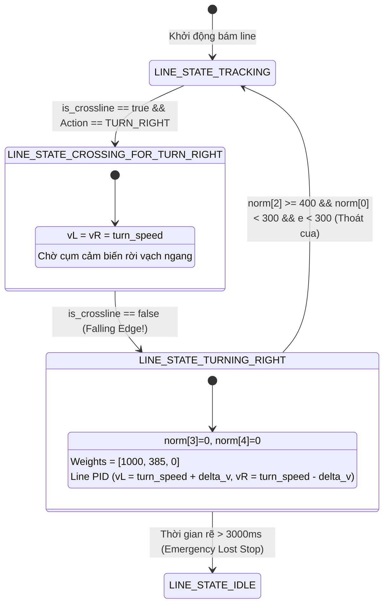

# Đặc tả Kỹ thuật: Điều Hướng Ngã Rẽ Sau Vạch Ngang & Bám Line 3 Mắt Phải (SPEC-crossline-exit-turn)

## 1. Giả Định Ban Đầu (Assumptions I'm Making)
1. **Hình học cơ khí**: Cụm 5 mắt cảm biến IR nằm ở đầu xe, cách trục bánh dẫn động vi sai một khoảng vươn tới (overhang) $\approx 10-15\text{ cm}$. Khi cảm biến chạm mép trước vạch ngang, bánh xe vẫn còn cách tâm giao lộ một khoảng tương ứng.
2. **Định nghĩa "Đã đi qua Crossline"**: Là thời điểm cạnh xuống (`falling edge`) của tín hiệu `is_crossline`, tức là cụm cảm biến từ trạng thái đè lên vạch ngang ($active\_count \ge 4$) chuyển sang trạng thái đã trượt khỏi vạch ngang ($active\_count < 4$). Tại thời điểm này, trục bánh xe đã tiến vào sát tâm giao lộ.
3. **Chế độ kích hoạt**: Áp dụng trong chế độ hành trình tự hành (`s_is_route_mode == true`) khi bước lộ trình hiện tại là rẽ phải (`action == AGV_ACTION_TURN_RIGHT`).
4. **Cảm biến sử dụng**: Khi rẽ phải, 2 mắt bên trái [IR3, IR4] bị triệt tiêu bằng 0; chỉ sử dụng 3 mắt bên phải [IR0(R2), IR1(R1), IR2(MID)] để dò tìm và bám theo nhánh rẽ phải qua Line PID.
5. **Độ an toàn**: Bổ sung bộ đếm thời gian tối đa (`TURN_MAX_TIMEOUT_MS = 3000ms`) để tự động dừng khẩn cấp nếu xe trôi ra ngoài sàn mà không tìm thấy nhánh rẽ mới.

---

## 2. Mục Tiêu & Tiêu Chí Nghiệm Thu (Objective & Acceptance Criteria)

### 2.1. Mục Tiêu
Nâng cấp máy trạng thái bám line trong `app_line_follow.c` để xe không bẻ lái sớm ngay mép trước của vạch ngang ngã rẽ. Xe tiếp tục lướt thẳng qua vạch ngang cho đến khi cảm biến thoát hẳn vạch (`falling edge`), sau đó lập tức chuyển sang chế độ dò 3 mắt phải với Line PID để ôm cua mượt mà vào đúng tâm giao lộ.

### 2.2. Tiêu Chí Nghiệm Thu (Acceptance Criteria)

- **AC-1 (Xuyên qua vạch ngang):** Khi phát hiện vạch ngang (`is_crossline == true`) tại bước có lệnh `AGV_ACTION_TURN_RIGHT`, xe không quay ngay mà chuyển sang trạng thái chờ thoát vạch (`LINE_STATE_CROSSING_FOR_TURN_RIGHT`), duy trì 2 bánh chạy thẳng đồng tốc $v_L = v_R = v_{turn}$.
- **AC-2 (Kích hoạt rẽ tại cạnh xuống):** Ngay chu kỳ 10ms đầu tiên mà `is_crossline` chuyển từ `true` sang `false`, xe lập tức kích hoạt `LINE_STATE_TURNING_RIGHT`.
- **AC-3 (Triệt tiêu 2 mắt trái):** Trong suốt quá trình `LINE_STATE_TURNING_RIGHT`, giá trị chuẩn hóa $norm[3]$ và $norm[4]$ luôn bằng 0.
- **AC-4 (Sai số hình học 3 mắt phải):** Sai số $e_{turn}$ được tính theo trọng số khoảng cách thực tế $[W_0=+1000, W_1=+385, W_2=0]$. Nếu chưa có mắt nào thấy vạch ($total < 200$), ép $e_{turn} = +1000$.
- **AC-5 (Line PID ôm cua):** Độ lệch tốc độ $\Delta v$ được tính qua Line PID với trần bão hòa `out_max = turn_speed`, giúp bánh trong giảm tốc về 0 RPM và bánh ngoài tăng tốc tối đa $2 \times v_{turn}$.
- **AC-6 (Điều kiện thoát rẽ):** Xe chuyển về `LINE_STATE_TRACKING` khi và chỉ khi: $t \ge 250\text{ms}$ VÀ $norm[2] \ge 400$ VÀ $norm[0] < 300$ VÀ $|e_{turn}| < 300$.
- **AC-7 (An toàn Timeout):** Nếu sau $3000\text{ms}$ kể từ khi bắt đầu rẽ mà chưa bắt được vạch mới, xe lập tức kích hoạt phanh khẩn cấp `App_LineFollow_Stop()` và bắn gói tin BLE `AGV_MISSION_ERROR_LOST`.

---

## 3. Ngăn Xếp Công Nghệ & Lệnh Thực Thi (Tech Stack & Commands)

- **Vi điều khiển:** STM32F103C8T6 (ARM Cortex-M3 72MHz, 64KB Flash, 20KB RAM)
- **Chuẩn C:** C11 (GNU11 Extensions), toolchain `arm-none-eabi-gcc 13.3.rel1`
- **Build System:** CMake 3.28+ & Ninja
- **Kiểm thử tự động:** Python 3.14 `unittest`

### Các lệnh thực thi (Executable Commands)
```bash
# Biên dịch Firmware STM32
cmake --build build/Debug

# Chạy toàn bộ Unit Test STM32
py -3 -m unittest discover tests

# Chạy Unit Test kiểm tra máy trạng thái điều hướng
py -3 -m unittest tests/test_line_follow_edge_cases.py

# Nạp Firmware qua ST-Link OpenOCD
openocd -f interface/stlink.cfg -f target/stm32f1x.cfg -c "program build/Debug/agv_stm32.elf verify reset exit"
```

---

## 4. Cấu Trúc Máy Trạng Thái Điều Hướng (FSM Navigation Architecture)

### 4.1. Bổ Sung Trạng Thái Mới trong `line_state_t`
```c
typedef enum {
    LINE_STATE_IDLE = 0,
    LINE_STATE_CALIBRATING,
    LINE_STATE_TRACKING,
    LINE_STATE_CROSS_LINE,                  /**< Đi thẳng qua vạch ngang thông thường */
    LINE_STATE_CROSSING_FOR_TURN_RIGHT,     /**< Đi thẳng xuyên qua vạch ngang để chuẩn bị rẽ phải */
    LINE_STATE_TURNING_LEFT,                /**< Quay tại chỗ rẽ trái 90° */
    LINE_STATE_TURNING_RIGHT,               /**< Dò 3 mắt phải qua Line PID ôm cua rẽ phải */
    LINE_STATE_LOST                         /**< Mất vạch dò tìm khẩn cấp */
} line_state_t;
```

### 4.2. Sơ Đồ Chuyển Trạng Thái (State Transition Diagram)


---

## 5. Thiết Kế Chi Tiết Thuật Toán & Giao Diện Dữ Liệu

### 5.1. Định Tuyến Cạnh Xuống Khi Qua Vạch Ngang
Tại vòng lặp điều khiển chính 100Hz (`App_LineFollow_Process`):
```c
/* Gặp vạch ngang khi đang bám line */
if (s_tracker.is_crossline) {
    if (now >= s_crossline_debounce_until) {
        if (s_is_route_mode) {
            uint8_t action = (s_route_step < s_route_count) ? s_route_actions[s_route_step] : AGV_ACTION_STOP;
            
            if (action == AGV_ACTION_TURN_RIGHT) {
                /* KHÔNG rẽ ngay: chuyển sang trạng thái chạy thẳng xuyên qua vạch ngang */
                s_state = LINE_STATE_CROSSING_FOR_TURN_RIGHT;
                s_turn_prep_start_tick = now;
                return;
            }
            // ... các action khác (FORWARD, TURN_LEFT, STOP)
        }
    }
}
```

### 5.2. Trạng Thái `LINE_STATE_CROSSING_FOR_TURN_RIGHT`
```c
if (s_state == LINE_STATE_CROSSING_FOR_TURN_RIGHT) {
    BSP_IR_GetRaw(s_last_raw);
    line_tracker_normalize(&s_tracker, s_last_raw, s_last_norm);
    line_tracker_compute_error(&s_tracker, s_last_norm);

    float turn_speed = s_base_rpm * 0.6f;
    if (turn_speed < 30.0f) turn_speed = 30.0f;

    /* Đi thẳng ổn định với tốc độ rẽ để tiến sâu vào giao lộ */
    App_MotorControl_SetTargetRPM(turn_speed, turn_speed);

    /* Phát hiện cạnh xuống: khi cảm biến vừa trượt khỏi vạch ngang */
    if (!s_tracker.is_crossline) {
        s_state = LINE_STATE_TURNING_RIGHT;
        s_turn_start_tick = now;
        line_tracker_reset(&s_tracker);
        s_route_step++; // Tăng bước lộ trình
    }
    return;
}
```

### 5.3. Trạng Thái `LINE_STATE_TURNING_RIGHT` (Dò 3 Mắt Phải)
```c
if (s_state == LINE_STATE_TURNING_RIGHT) {
    /* Kiểm tra Timeout an toàn 3.0s */
    if ((uint32_t)(now - s_turn_start_tick) >= TURN_MAX_TIMEOUT_MS) {
        App_LineFollow_Stop();
        s_is_route_mode = false;
        App_Comms_SendMissionStatus(AGV_MISSION_ERROR_LOST, s_route_step);
        return;
    }

    BSP_IR_GetRaw(s_last_raw);
    line_tracker_normalize(&s_tracker, s_last_raw, s_last_norm);

    /* 1. Triệt tiêu 2 mắt bên trái */
    s_last_norm[3] = 0;
    s_last_norm[4] = 0;

    /* 2. Tính sai số theo khoảng cách hình học thực tế */
    int32_t norm_r2 = (int32_t)s_last_norm[0];
    int32_t norm_r1 = (int32_t)s_last_norm[1];
    int32_t norm_mid = (int32_t)s_last_norm[2];
    int32_t total_right = norm_r2 + norm_r1 + norm_mid;
    int16_t turn_err;

    if (total_right < 200) {
        turn_err = 1000; // Ép bẻ lái cực đại sang phải
    } else {
        int32_t sum_w = norm_r2 * LINE_TRACKER_WEIGHT_OUTER + norm_r1 * LINE_TRACKER_WEIGHT_INNER;
        turn_err = (int16_t)(sum_w / total_right);
        if (turn_err > 1000) turn_err = 1000;
        if (turn_err < 0) turn_err = 0;
    }
    s_last_error = turn_err;

    /* 3. Line PID điều khiển ôm cua vi sai */
    float turn_speed = s_base_rpm * 0.6f;
    if (turn_speed < 30.0f) turn_speed = 30.0f;
    s_tracker.pid_cfg.out_max = turn_speed;

    float delta_v = line_tracker_compute_pid(&s_tracker, turn_err, 0.01f);
    float target_l = turn_speed + delta_v;
    float target_r = turn_speed - delta_v;

    /* 4. Điều kiện thoát rẽ khi vạch nhánh đã vào tâm */
    if ((uint32_t)(now - s_turn_start_tick) >= TURN_MIN_DURATION_MS) {
        bool center_on_line = (norm_mid >= 400);
        if (center_on_line && norm_r2 < 300 && turn_err < 300 && !s_tracker.is_crossline) {
            s_state = LINE_STATE_TRACKING;
            s_crossline_debounce_until = now + CROSSLINE_DEBOUNCE_MS;
            s_lost_start_tick = 0;
            s_tracker.pid_cfg.out_max = (s_base_rpm >= 60.0f) ? s_base_rpm : 60.0f;
            line_tracker_reset(&s_tracker);
        }
    }

    App_MotorControl_SetTargetRPM(target_l, target_r);
    return;
}
```

---

## 6. Các Hằng Số Cấu Hình (Constants & Configuration)

| Tên Macro | Giá Trị Mới | Đơn Vị | Ý Nghĩa Kỹ Thuật |
| :--- | :---: | :---: | :--- |
| `CROSSLINE_DEBOUNCE_MS` | `200` | ms | Thời gian khóa nhận diện sau khi vừa hoàn thành giao lộ |
| `TURN_MIN_DURATION_MS` | `250` | ms | Thời gian quay tối thiểu bắt buộc để đầu xe thoát góc cũ |
| `TURN_MAX_TIMEOUT_MS` | `3000` | ms | Thời gian ngắt khẩn cấp an toàn nếu rẽ quá 3 giây không thấy vạch |
| `LINE_TRACKER_WEIGHT_OUTER` | `1000` | — | Trọng số mắt IR0 (+32.5mm) |
| `LINE_TRACKER_WEIGHT_INNER` | `385` | — | Trọng số mắt IR1 (+12.5mm) |
| `LINE_TRACKER_WEIGHT_CENTER`| `0` | — | Trọng số mắt IR2 (0mm) |

---

## 7. Ranh Giới Phát Triển (Development Boundaries)

- **Luôn luôn làm (Always):**
  - Giữ nguyên kiến trúc Zero-malloc, 100% bộ nhớ tĩnh trên STM32.
  - Reset tích phân PID khi chuyển đổi trạng thái để chống sốc gia tốc.
  - Cập nhật unit test và chạy đạt 100% trước khi commit.
- **Hỏi trước khi làm (Ask first):**
  - Mở rộng logic tương tự cho rẽ trái `LINE_STATE_TURNING_LEFT`.
  - Thay đổi giao thức gói tin truyền với ESP32.
- **Tuyệt đối không làm (Never):**
  - Dùng `HAL_Delay()` gây đứng vòng lặp 100Hz của hệ thống.
  - Bỏ qua cơ chế timeout 3.0 giây khi vào khúc cua.

---

## 8. Kế Hoạch Kiểm Thử (Testing Strategy)

1. **Unit Test FSM (`test_line_follow_edge_cases.py`):**
   - Kiểm tra định nghĩa hằng số `TURN_MAX_TIMEOUT_MS == 3000`.
   - Kiểm tra sự tồn tại của trạng thái `LINE_STATE_CROSSING_FOR_TURN_RIGHT`.
   - Kiểm tra logic chuyển cạnh xuống: `is_crossline: true -> false` kích hoạt rẽ phải.
2. **Unit Test Thuật Toán Trọng Số 3 Mắt:**
   - Kiểm tra đáp ứng $e_{turn}$ khi vạch quét từ IR0 $\rightarrow$ IR1 $\rightarrow$ IR2.
3. **Biên Dịch Sạch Sẽ:**
   - `cmake --build build/Debug` không có cảnh báo (`-Wall -Werror`).
